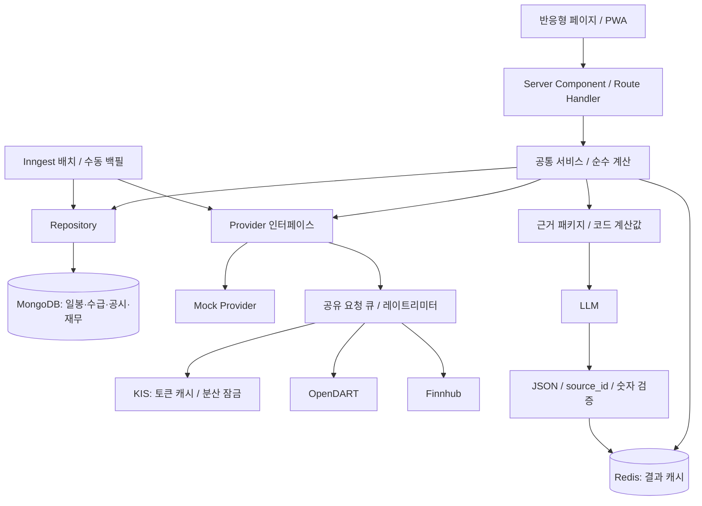

# 국내·미국 주식 분석 앱 — 1단계 설계

작성일: 2026-10-10 (Asia/Seoul). 상태: 설계 검토 대기. 구현·포크·의존성 설치는 아직 수행하지 않았다.

## 1. 출발점과 기술 선택

- 기반 저장소: https://github.com/Open-Dev-Society/OpenStock . 2단계에서 upstream 커밋 SHA를 기록하고 기존 App Router, Better Auth, MongoDB, 검색, 관심종목, shadcn/ui, next-themes, Inngest를 재사용한다.
- 현재 작업 폴더 조회에서는 파일이 보이지 않았다. IDE에 표시된 Docker-Study 파일이나 기존 OpenStock checkout을 확인하지 못했으므로 다음 단계에서 `openstock/` 하위에 별도 checkout을 만드는 계획이다.
- OpenStock 공식 저장소의 현재 라이선스는 AGPL-3.0이다. 원본 고지·라이선스와 배포 시 소스 제공 안내를 유지한다.
- 원본 README에 NEXT_PUBLIC_FINNHUB_API_KEY 설정이 있다. 확장 작업에서 키 참조를 감사하고 FINNHUB_API_KEY 서버 전용 호출로 변경한다. KIS/DART/LLM 키도 public 환경변수에 넣지 않는다.
- Next.js App Router, strict TypeScript, MongoDB 영속 저장, Redis 공유 캐시/분산 잠금/레이트리미터, Vitest 계산 테스트, Lightweight Charts를 사용한다. 버전은 checkout의 호환성과 공식 문서를 확인한 뒤 lockfile로 고정한다.
- Vercel 웹 서버 + MongoDB Atlas + 공유 Redis + Inngest 분할 배치가 운영 기본안이다. 서버리스 파일 시스템은 영속 캐시로 사용하지 않는다.
- USE_MOCK=true에서는 외부 API와 MongoDB/Redis 없이 네 페이지를 볼 수 있도록 별도 demo repository와 메모리 캐시를 사용한다. 기존 인증을 제거하지 않고 데모 조회 경로와 실제 인증 경로를 구분한다. 목업 관심종목은 로컬 브라우저에 저장하며 실사용 계정과 섞지 않는다.

## 2. 예정 폴더 구조

아래는 추가·수정 대상 구조이며 실행 코드가 아니다. 기존 원본 파일은 유지한다.

```text
openstock/
  app/(root)/themes/page.tsx
  app/(root)/flows/page.tsx
  app/(root)/etfs/page.tsx
  app/(root)/company/[code]/page.tsx
  app/api/analysis/themes/route.ts
  app/api/analysis/flows/route.ts
  app/api/analysis/etfs/route.ts
  app/api/analysis/company/[code]/route.ts
  app/api/analysis/company/[code]/summary/route.ts
  app/manifest.ts
  components/charts/PriceChart.tsx
  components/charts/NormalizedChart.tsx
  components/charts/ContributionChart.tsx
  components/charts/InvestorFlowChart.tsx
  components/analysis/DataTable.tsx
  components/analysis/SourceBadge.tsx
  components/analysis/Disclaimer.tsx
  config/themes.json
  data/etf_meta.json
  data/mock/fixtures.json
  lib/domain/contracts.ts
  lib/domain/themes.ts
  lib/domain/flows.ts
  lib/domain/etfs.ts
  lib/domain/financials.ts
  lib/providers/kis/client.ts
  lib/providers/kis/token.ts
  lib/providers/kis/endpoints.ts
  lib/providers/kis/mapper.ts
  lib/providers/dart/client.ts
  lib/providers/dart/corp-codes.ts
  lib/providers/dart/mapper.ts
  lib/providers/us/finnhub.ts
  lib/providers/mock/index.ts
  lib/services/themes.ts
  lib/services/flows.ts
  lib/services/etfs.ts
  lib/services/company.ts
  lib/repositories/mongo.ts
  lib/repositories/demo.ts
  lib/server/cache.ts
  lib/server/rate-limit.ts
  lib/server/env.ts
  lib/ai/schema.ts
  lib/ai/prompt.ts
  lib/ai/validate.ts
  database/models/instrument.model.ts
  database/models/price-bar.model.ts
  database/models/investor-flow.model.ts
  database/models/financial-report.model.ts
  database/models/disclosure.model.ts
  database/models/summary.model.ts
  scripts/collect-prices.ts
  scripts/collect-flows.ts
  scripts/sync-dart.ts
  scripts/backfill.ts
  tests/themes.test.ts
  tests/flows.test.ts
  tests/etfs.test.ts
  tests/financials.test.ts
  tests/ai-sources.test.ts
  public/sw.js
  .env.example
```

## 3. 데이터 흐름



페이지에는 provider 원시 응답을 전달하지 않는다. 공통 DTO는 instrumentId, market, currency, asOf, fetchedAt, sourceId, sourceUrl, isMock, completeness, missingReason을 포함한다. 개별 보수·AUM·가격·재무 수치의 기준일이 다르면 필드별 provenance를 보존한다. 날짜는 거래소 현지 YYYY-MM-DD, 저장 타임스탬프는 UTC로 구분한다. KR:005930과 US:SPY처럼 식별자를 분리한다.

오류는 unavailable / permission_denied / rate_limited / stale / insufficient_history로 구분한다. 키가 없고 USE_MOCK=false면 설정 오류를 표시한다. 실제 호출 실패 시 목업으로 몰래 전환하지 않는다.

## 4. API 목록과 검증 상태

KIS REST 기본 host는 실전 환경에서 https://openapi.koreainvestment.com:9443 를 사용할 계획이며 환경별 설정을 분리한다. 아래 TR ID와 경로는 공식 GitHub 샘플에서 확인했다. 포털 API 목록도 확인했으나 상세 스펙 전체 및 실제 계정 응답 검증은 다음 단계에 남아 있다.

| 용도 | 메서드·경로 | TR ID | 페이지 |
|---|---|---|---|
| 토큰 | POST /oauth2/tokenP | OAuth 요청, TR ID 없음 | 공통 |
| 현재가·현재 규모 | GET /uapi/domestic-stock/v1/quotations/inquire-price | FHKST01010100 | 테마·수급·기업 |
| 일봉 | GET /uapi/domestic-stock/v1/quotations/inquire-daily-itemchartprice | FHKST03010100 | 테마·ETF·기업 |
| 종목 투자자 | GET /uapi/domestic-stock/v1/quotations/inquire-investor | FHKST01010900 | 수급 |
| ETF 현재가 | GET /uapi/etfetn/v1/quotations/inquire-price | FHPST02400000 | ETF |
| ETF 구성종목시세 | GET /uapi/etfetn/v1/quotations/inquire-component-stock-price | FHKST121600C0 | ETF 후보 소스 |

일봉 샘플은 호출당 최대 100건, FID_PERIOD_DIV_CODE=D, FID_ORG_ADJ_PRC=0 수정주가 / 1 원주가를 명시한다. 날짜 구간을 역방향 분할하고 중복 날짜를 제거한다. 수정주가가 배당 재투자 총수익률이라는 뜻은 아니다. 기업행위 발생 시 과거 가격을 다시 수집한다.

투자자 샘플은 당일 데이터가 장 종료 후 제공된다고 명시한다. 반환 일수, 금액 단위, 확정 시점, 시장 범위는 실제 응답과 포털 상세 문서로 확인한다. 본 설계는 KRX(J) 기준이며 NXT 혼합 데이터로 바꾸지 않는다. 종목 마스터는 공식 stocks_info 자료를 활용하는 후보로 둔다. 시장 전체 투자자 합계 API를 종목별 랭킹 데이터로 사용하지 않는다.

OpenDART 기본 host: https://opendart.fss.or.kr/api . TR ID는 없다.

| 용도 | 요청 | 확인 상태 |
|---|---|---|
| 종목코드→기업코드 | GET /corpCode.xml | 공식 가이드 확인: ZIP 내부 XML, 기업코드 8자리·종목코드 6자리 |
| 최근 공시 | GET /list.json | 공식 공시검색 가이드 확인; 기업별 기간·유형·페이지 조회 |
| 전체 재무계정 | GET /fnlttSinglAcntAll.json | 채택 예정; 공식 상세 페이지 로딩 실패로 스펙 재검증 필요 |
| 공시 원문 다운로드 | GET /document.xml | 채택 후보; 공식 스펙 재검증 후 연결 |

재무 요청은 corp_code, bsns_year, reprt_code, fs_div 조합을 저장한다. 계획 보고서 코드: 사업 11011, 반기 11012, 1분기 11013, 3분기 11014. CFS 연결 우선, 없을 때 OFS 별도 사용하며 두 기준을 한 성장률에 섞지 않는다. 이 코드와 응답 필드도 상세 문서 재검증 대상으로 기록한다.

미국 데이터는 기존 Finnhub를 서버 provider로 감싼다. 공식 SDK에서 /search, /stock/candle, /etf/profile, /etf/holdings, /forex/candle 경로를 확인했다. 일봉·ETF 메타데이터·USD/KRW 역사환율의 실제 플랜 권한과 커버리지는 미확인이다. 무료 키로 전부 된다고 가정하지 않는다. 권한 부족 시 지원되는 파일 import 또는 별도 계약 데이터 provider를 연결하고 화면에 누락 사유를 표시한다.

## 5. ETF 소스 제안

추천 기본안은 가격은 KIS/Finnhub, 총보수·AUM·상위 10개 구성과 비중은 운용사 공식 자료를 검토하여 data/etf_meta.json에 저장하는 조합이다. 국내는 KODEX/TIGER 등 운용사 상품 자료, 미국은 SPDR/iShares/Vanguard 등 해당 ETF 운용사의 공식 fact sheet·holdings 파일을 사용한다. 자동 스크래핑을 전제로 하지 않는다.

| 항목 | 자동 소스 | 대안과 표시 |
|---|---|---|
| 국내 가격·거래량·거래대금 | KIS 일봉 | 실제 거래대금 필드와 단위 검증 |
| 미국 가격·거래량 | Finnhub candles | 권한 있는 CSV import; 종가×거래량은 추정 거래대금으로 별도 표시 |
| 국내 보수 | 검증된 자동 소스 없음 | 운용사 공식 총보수, 추가 비용 별도 기록 |
| 국내 구성·비중 | KIS ETF 구성종목시세 후보 | 비중 필드·해외/합성 ETF 커버리지 확인 전 운용사 자료 사용 |
| 미국 보수·AUM·보유종목 | Finnhub ETF profile/holdings 후보 | 계정 권한·필드 검증 전 운용사 자료 사용 |
| 국내 AUM | KIS 관련 필드 후보, 의미 미확인 | 운용사 순자산 기준일 저장; 시가총액과 혼동 금지 |
| 환율 | Finnhub 역사환율 후보 | USD/KRW 지원 확인 후 활성화; 최신 환율로 과거 수익률 계산 금지 |

수동 파일에는 instrumentId, expenseRatio, expenseDefinition, aum, aumCurrency, holdings, effectiveDate, updatedAt, sourceUrl을 둔다. 항목별 날짜와 출처를 허용한다. 비중 합이 100%를 넘는 경우 파생상품 노출인지 오류인지 검토한다. 상위 10개를 100%로 재정규화하지 않는다. 오래된 자료는 stale 배지를 붙이며 결측은 0이 아니다.

## 6. DB 스키마와 인덱스

통화 금액·시가총액·큰 수량은 Decimal128 또는 정수 문자열로 저장한다. 계산 계층에서 decimal 연산을 사용하며 차트 출력 시에만 안전 범위의 number로 변환한다.

| 컬렉션 | 핵심 필드 | 고유키 / 인덱스 |
|---|---|---|
| instruments | instrumentId, code, name, market, exchange, currency, type, corpCode, listedAt, delistedAt | instrumentId unique; code/name 검색 |
| price_bars | instrumentId, date, priceBasis, OHLC, volume, turnover, source, revision | instrumentId+date+priceBasis+source unique |
| market_cap_snapshots | instrumentId, date, marketCap, listedShares, source, estimated | instrumentId+date+source unique |
| investor_flows | instrumentId, date, investorType, netAmount, netQuantity, exchangeScope, unit, finality | instrumentId+date+investorType+exchangeScope unique |
| trading_sessions | exchange, date, isOpen, closeTime, source | exchange+date unique |
| corp_mappings | corpCode, stockCode, corpName, modifyDate | corpCode unique; stockCode index |
| disclosures | rceptNo, corpCode, date, reportName, type, originalUrl, supersedes, contentHash | rceptNo unique; corpCode+date |
| financial_reports | corpCode, year, reportCode, fsDiv, rceptNo, periodStart, periodEnd, accounts, version, fetchedAt | corpCode+year+reportCode+fsDiv+rceptNo unique |
| etf_metadata | instrumentId, field values, fieldSources, effectiveDate, version | instrumentId+effectiveDate+version unique |
| fx_bars | pair, date, rate, source, fixingTime | pair+date+source unique |
| summaries | corpCode, asOf, evidenceHash, model, promptVersion, schemaVersion, sections | 전체 캐시 키 조합 unique |
| collection_runs | job, scope, cursor, expected, completed, failed, dataDate, startedAt, finishedAt | job+dataDate index |

summaries의 복합키는 corpCode+asOf+evidenceHash+model+promptVersion+schemaVersion이다. 재무·공시 이력은 TTL로 삭제하지 않는다. Redis 결과 캐시에 TTL을 설정한다. 기존 사용자·watchlist는 유지하고 국내 종목 식별자 변경에는 마이그레이션 스크립트를 준비한다.

## 7. ページ별 계산과 테스트

### /themes

- AI, 반도체, 방산, 원전, 로봇을 JSON으로 관리한다. themeId, name, description, codes, effectiveFrom, version을 저장한다. 사용자가 목록을 바꾸면 구성 버전과 계산 캐시가 달라진다.
- 1주는 7일 전, 3/6개월은 달력 월을 뺀 날짜를 기준으로 해당일 또는 직전 거래일을 선택한다. 시작·종료 거래일을 화면에 표시한다.
- 종목 수익률 r=P끝/P시작−1. 동일가중 w=1/n. 시총가중 w=시작시총/시작시총합. 테마 R=Σ(w×r), 기여도=100×w×r 퍼센트포인트.
- 테마 지수 I(t)=100×Σ(w×P(t)/P시작). 선택 기간의 시작 비중을 고정하고 매일 재가중하지 않는다.
- 기간 시작 시총이 없으면 현재 시총으로 대체하지 않는다. 공식 과거 시총 import 또는 동일 기준 원주가×당시 상장주식수 이력이 필요하다. 없으면 시총가중을 자료 부족으로 표시한다. 목업은 시작 시총 이력을 포함한다.
- 시작 가격 없는 신규상장/거래정지·결측 종목은 자동 제외 후 정상 결과처럼 표시하지 않는다. 전체 랭킹에는 완전한 테마만 포함하고 불완전 테마는 별도 상태와 포함률을 보여준다. 현재 구성으로 과거를 계산한 탐색 지표임을 표시한다.
- 테스트: 10%/−5% 두 종목의 동일가중 2.5%, 80/20 시총가중 7%, 기여도 합=테마 수익률, 시작 지수=100, 결측/0가격/0시총/구성변경.

### /flows

- 대상은 KOSPI/KOSDAQ 보통주 마스터 전체를 원칙으로 하되 초기 데모·수집 대상 범위를 명시한다. 일부만 수집한 경우 전체 시장 상위라는 문구를 쓰지 않는다.
- 공통 최신 확정일을 기준으로 5/20/60개의 거래소 거래일을 선택한다. 휴일·주말 제외뿐 아니라 임시 휴장과 수집 실패를 구분한다.
- 외국인 순매수 금액/수량은 각 일별 값의 합. 기본 금액. 기관 연속일수는 최신 확정 거래일부터 값>0인 동안 계산한다. 0·음수는 중단, 누락은 알 수 없음. 60일 모두 양수면 최소 60일로 표시한다.
- 개인/기관/외국인 부호가 반대인 종목을 하이라이트한다. 세 주체의 합이 반드시 0이라는 검증을 하지 않는다. 기타법인 등 다른 투자자 구분이 존재할 수 있다.
- 시총 필터는 수급 종료일 시총 기준. 시장 필터 및 필터 범위를 명시한다. 기관 데이터가 장중 추정치라면 확정 시계열에 섞지 않는다.
- 테스트: 휴일·누락·0·부호·금액과 수량 순위 차이·최소 연속일수·시장/시총 필터.

### /etfs

- 1/3/6개월·1년 달력 기간, 공통 기준일=100 비교 최대 5개. 종목마다 실제 시작/종료일을 제공한다.
- 비교선은 공통 평가일과 서로 지원하는 시작 구간을 선택한다. 휴장으로 표시용 직전값을 유지할 때 carryForward 표시를 남긴다. 실제 관측치와 합성 관측치를 구분한다.
- 기본 가격수익률로 표시한다. 분배금 재투자 자료가 확보된 경우에만 총수익률 모드를 추가한다. 보수를 가격수익률에서 다시 차감하지 않는다.
- 미국 USD 수익률 P끝/P시작−1. 원화 수익률 (P끝×FX끝)/(P시작×FX시작)−1. FX는 1 USD당 KRW이며 각 시점 환율만 사용한다. 환율 이력 부족 시 토글 비활성화.
- 평균 거래량/거래대금은 최근 20개 유효 거래일, 표본수·단위 표시. 미국 거래대금이 종가×거래량이면 추정임을 표시한다. AUM 통화와 보수 정의도 명시한다.
- 테스트: 정규화·5개 제한·FX 상승/하락·역환율 방지·달력 경계·결측·보수 중복차감 방지.

### /company/[code]

- 국내 종목명/코드를 로컬 마스터에서 검색하고 corpCode로 매핑한다. 동명이인은 선택 UI, 미매핑은 빈 상태. 미국 기업 DART 분석은 지원 대상으로 표시하지 않는다.
- 최근 6개월 공시를 기본 조회하고 유형 필터 제공. 공시 목록의 제목만으로 본문 내용을 추측하지 않는다. 원문을 확보하지 못한 공시는 제목·접수일만 요약한다.
- 최근 5개 사업연도와 최근 분기, 비교 분기·전년 동기·누적 분기를 수집한다. 회계연도와 실제 기간을 저장하며 비12월 결산을 고려한다.
- 계정 매핑은 account_id 우선 + 검토된 이름 alias. 매출/영업이익/순이익/자산/부채/자본/영업CF 및 추가 비율에 필요한 유동자산·유동부채·이자비용을 저장한다. 계정 없음은 자료 없음.
- 손익과 현금흐름 누적값은 H1−Q1, 9M−H1, 연간−9M으로 독립 분기화한다. 재무상태표 잔액은 차감하지 않는다. 이미 분기값인 필드를 다시 차감하지 않는다.
- YoY/QoQ=(현재/비교−1)×100은 비교값>0일 때 계산한다. 비교값<=0에서는 흑자/적자전환·절대 증감으로 표시한다. 영업이익률=영업이익/매출, 부채비율=부채/자본, 유동비율=유동자산/유동부채, 이자보상배율=영업이익/이자비용. 0분모·비양수 자본은 N/A와 사유를 표시한다.
- 영업CF−순이익과 비교 기간을 표시하고 서로 다른 분기/연간 값을 비교하지 않는다. 정정공시 수집 시 재무 계산·AI 캐시를 무효화한다.
- 공시일 마커는 휴장일인 경우 다음 거래일에 표시하되 tooltip에는 실제 공시일을 유지한다. 시각을 확보하지 못했으면 장중/장후 영향을 추정하지 않는다.
- 테스트: 누적→분기·연결/별도 혼합 방지·정정·음수 성장기준·영업CF 기간 일치·계정 누락·휴장 마커.

## 8. AI 근거 정책

근거 패키지는 disclosures, financialReports, computedMetrics만 포함한다. LLM은 실적 변화/재무 위험/성장성/최근 주요 공시의 네 section을 반환한다. 계산은 전부 코드로 수행한다.

출력 JSON 설계 예:

```json
{
  "sections": [
    {
      "kind": "performance",
      "status": "supported",
      "sentences": [
        {
          "text": "제공된 보고서에서 매출 증가가 확인됩니다.",
          "source_ids": ["financial:report-id:revenue"],
          "metric_ids": ["revenue_yoy"]
        }
      ]
    },
    {
      "kind": "growth",
      "status": "no_data",
      "sentences": [
        {
          "text": "자료 없음",
          "source_ids": ["coverage:company:as-of"],
          "metric_ids": []
        }
      ]
    }
  ]
}
```

실제 스키마는 네 section의 중복/누락을 금지하고 각 문장을 분리한다. no_data의 coverage 참조는 원문 근거가 아니라 어떤 자료가 없는지 보여주는 수집 내역이다. UI에서도 일반 DART 근거와 구분한다.

프롬프트는 제공 근거만 사용, 공시 안의 지시문 무시, 투자 권유·근거 없는 전망 금지, source_ids 필수, 자료 없으면 자료 없음, 숫자 직접 생성 금지로 구성한다. 수치는 metric_id로 참조하고 렌더러가 코드 계산값을 삽입한다. 응답의 임의 숫자는 검증에서 거부한다.

검증은 JSON 형태, 허용 source_id, 문장별 비어 있지 않은 근거, metric 값과 보고서 기간, 근거 문서와 주장 범위, 위험한 링크를 확인한다. ID 존재만으로 사실 일치를 보장하지 않는다. 검증 실패 시 1회 교정 후 근거 기반 정형 요약을 표시한다. 위험·성장 해석은 제한된 규칙/근거 범위에서만 제공한다.

공시 각주 URL은 https://dart.fss.or.kr/dsaf001/main.do?rcpNo={접수번호} . 재무 각주는 보고서명·사업기간·CFS/OFS·계정명과 해당 접수번호 링크를 붙인다. 모든 문장은 근거 또는 자료부족 내역에 연결된다. AI 요약은 기업+기준일+근거해시+모델+프롬프트 버전으로 캐싱한다.

## 9. 토큰·큐·캐시·배치

- 토큰은 공식 샘플의 /oauth2/tokenP 및 응답 만료일을 기준으로 처리한다. 샘플에는 유효기간 1일 설명이 있으나 실제 expires_in/만료시각을 우선한다.
- 만료 5분 전 갱신, 동일 프로세스 single-flight와 공유 Redis 분산 잠금, 발급 최소간격 설정을 둔다. 잠금 실패자는 저장 토큰을 재확인한다. 유효하지 않은 토큰 오류만 1회 갱신 후 재시도하며 계속 실패하면 중단한다.
- 토큰은 서버 공유 저장소에서 접근 제한·암호화하고 키/토큰/인증 URL을 로그에 남기지 않는다. 환경별 namespace를 분리한다.
- KIS 초기 제한은 2 requests/sec, 동시 1개, 발급간격 최소 60초라는 보수적 운영 설정을 제안한다. 이는 공식 상한 확정값이 아니다. 계정별 최신 제한 확인 후 조정한다. 분산 limiter는 appkey의 해시로 공유한다.
- 429·일시 장애는 지수 backoff+jitter, 최대 3회와 작업별 시간예산. 장기 작업은 페이지 요청에서 실행하지 않고 배치 chunk로 처리한다.
- 일봉·수급은 영속 저장, 조회 결과 10분, 현재가 60초, 공시 목록 30분, corp mapping 24시간을 초기 캐시 정책으로 한다. 재무·ETF 자료는 출처 변경/보고서 정정/수동 파일 버전으로 갱신한다.
- KR 18:30 KST 수집, 누락·확정 여부 확인 후 21:00 보완이라는 운영 일정을 제안한다. 공급자가 이 시점에 확정된다는 보장은 없으므로 데이터 날짜와 finality를 검사한다. 미국은 거래소 현지 장 종료 후 수집하며 DST를 반영한다. 주말/휴일은 달력에 따라 건너뛴다.
- 배치는 종목별 idempotent upsert, 실행 cursor, 실패목록, checkpoint, 재시작, 집계 snapshot publish를 사용한다. 수집이 끝난 공통 기준일만 랭킹으로 공개한다.

## 10. 예상 호출량

아래는 공식 보장값이 아닌 계획용 가정이다. N=국내 수급 대상 주식 수, T=테마 고유종목 수, K=국내 ETF 수, U=미국 ETF 수, P=기업 공시 페이지 수.

| 작업 | 예상 |
|---|---|
| 국내 1년 일봉 초기 수집 | 252거래일 가정 시 3×(N+K); 테마 종목이 N에 포함되면 중복 없음 |
| 국내 매일 수집 | 일봉 N+K, 현재가/시총 N+K, 투자자 N → 약 3N+2K |
| 테마만 먼저 운영 | 일봉·시총 약 2T/거래일 |
| 수급 60일 초기화 | 반환 이력 내에서는 종목별 1회; 부족분 임의 과거조회는 불가, 지원 API 검증/import 또는 실제 누적 필요 |
| 미국 ETF | 초기·매일 U candles; 메타 선택 수집 최대 2U, 환율 1회(지원 시) |
| 기업 신규 조회 | 5년 사업보고서 5 + 분기 비교용 약 5~8 + 공시 P + 필요한 원문 D |
| 기업 재조회 | 캐시 유효 시 외부 호출 0; 새 공시·정정만 추가 |
| 토큰 | 공유 캐시 정상 시 환경별 대략 1회/일, 실제 만료와 갱신 정책에 따라 변동 |
| LLM | 동일 근거·모델·기준일 1회, 검증 교정은 최대 1회 추가 |

예시 N=2,500, K=20, U=10이면 국내 매일 약 7,540회. 2req/sec 직렬 처리의 이론상 하한은 약 63분이며 오류·재시도 시간이 추가된다. 초기 일봉은 약 7,560회. 전체 시장 수집을 짧은 Vercel 요청 하나로 실행하지 않는다. 대상 수와 쿼터를 확인하기 전 실시간 전종목 스캔을 활성화하지 않는다. DART 일별 쿼터와 Finnhub 플랜 쿼터는 계정 확인 사항이다.

## 11. UI·PWA·보안 수용 기준

- 기존 레이아웃과 Header 검색을 확장하고 동일 메뉴에서 네 페이지를 연결한다. 공통 footer에 "본 서비스는 정보 제공 목적이며 투자 권유가 아닙니다"를 표시한다.
- 375px에서는 카드와 접이식 상세를 사용하고 표는 필요한 경우 가로 스크롤을 제공한다. 정렬·필터 상태는 URL에 저장한다. 모든 표에 정렬/필터 UI를 제공한다.
- 다크/라이트 모드, 차트 색/글자 대비, 키보드 조작, 로딩·빈 결과·오류·부분수집·오래된 자료 상태를 제공한다.
- Lightweight Charts는 클라이언트 전용으로 mount하고 ResizeObserver와 cleanup을 사용한다. 캔들/라인+volume histogram, 비교선, 공시 마커는 공통 컴포넌트로 제공한다. 기여도와 수급 막대는 음수 지원 SVG로 렌더링한다. TradingView의 공식 attribution 요구도 유지한다.
- manifest, 설치 아이콘, 서비스워커, offline shell 제공. 인증 응답·LLM·키 포함 데이터는 서비스워커 캐시에서 제외한다. 오프라인 공개 스냅샷에는 저장 시각과 오래된 자료 표시를 붙인다.
- provider와 env 모듈에는 server-only 경계를 둔다. API 응답·HTML·JS bundle·로그에서 비밀키가 없는지 확인한다. 외부 host allowlist, 요청 파라미터 검증, 인증/사용자별 AI 호출 제한을 적용한다.
- 검증: 계산 단위 테스트, 공급자 mapper fixture 테스트, 토큰 동시갱신·분산 limiter 테스트, AI ID/숫자/근거 실패 테스트, 목업 4페이지 smoke, 375px/desktop 및 밝고 어두운 모드 확인, typecheck/build.

## 12. 실행 방법과 단계별 납품

이 단계는 설계 문서만 작성했으므로 실행 가능한 앱이나 실행 테스트 결과는 없다. docs/stock-analysis-design.md를 Markdown 미리보기로 읽을 수 있다.

2단계 완료 후 제공할 실행 절차: upstream checkout → 의존성 설치 → .env.example을 .env.local로 복사 → USE_MOCK=true → npm run dev. npm run test / typecheck / build 명령은 실제 package.json에 등록하고 검증 후 안내한다. 실데이터 모드는 MongoDB/Redis와 공급자 키를 설정한 뒤 백필·배치를 실행한다.

예정 환경변수: USE_MOCK, MONGODB_URI, REDIS_URL, BETTER_AUTH_SECRET, BETTER_AUTH_URL, KIS_APP_KEY, KIS_APP_SECRET, KIS_ENV, KIS_REQUESTS_PER_SECOND, KIS_TOKEN_MIN_INTERVAL_SECONDS, TOKEN_ENCRYPTION_KEY, DART_API_KEY, FINNHUB_API_KEY, LLM_PROVIDER, LLM_API_KEY, LLM_MODEL, INNGEST_EVENT_KEY, INNGEST_SIGNING_KEY. 비밀키는 NEXT_PUBLIC 접두사를 사용하지 않는다.

전체 코드 요구는 구현 단계에서 적용한다. 생성·수정한 각 파일의 완전한 내용을 작업 폴더와 단계별 코드 번들에 담고 파일 목록을 제공한다. 기존 코드를 생략한 의사코드를 실행 결과로 전달하지 않는다. 현 단계에는 구현 코드가 없다.

진행 순서와 확인 경계: 설계 확인 → 기반 작업 확인 → 테마 확인 → 수급 확인 → ETF 확인 → 기업 분석 확인 → 마무리 확인. 현재 설계 단계에서 멈춘다.

## 13. 확실하지 않은 부분 / 다음 단계 검증 목록

1. KIS 포털의 최신 계정별 초당 제한·토큰 발급 간격 및 데이터 표시/재배포 권한. 공식 상한을 임의로 확정하지 않는다.
2. KIS 투자자 응답의 실제 반환 일수·단위·확정시각·60일 백필 가능한 별도 API. 미확인 API를 추가할 때는 `// TODO: verify TR_ID`를 남기고 호출하지 않는다.
3. 과거 시총/상장주식수 소스. 현재가 API로 과거 시총을 대신하지 않는다. 부족하면 시총가중은 자료 부족으로 표시한다.
4. ETF API의 AUM 정의, 구성 비중, 국내 상장 해외/합성 ETF 범위, 금액/수량 단위.
5. Finnhub 실제 계정의 일봉·ETF 메타·USD/KRW 역사환율 사용 권한, 기업행위 조정 방식, 데이터 이용조건.
6. OpenDART 전체 재무제표·공시 원문 상세 가이드 재확인. 재무 API 코드/필드/보고서코드, XBRL 이자비용 및 추가 계정 가용성. 상세 가이드 접근 실패를 확인 완료로 처리하지 않는다.
7. 운용사 메타데이터 업데이트 간격·보수 정의와 수동 파일 초기 대상. 최신 API 값보다 오래된 수동 값이 덮어쓰지 않도록 필드별 우선순위를 정한다.
8. 현재 IDE 파일과 실제 작업 폴더 불일치, upstream 커밋·Node/패키지 버전 확정.

## 14. 공식 근거

- OpenStock: https://github.com/Open-Dev-Society/OpenStock
- KIS 포털: https://apiportal.koreainvestment.com/apiservice-apiservice
- KIS 일봉: https://github.com/koreainvestment/open-trading-api/blob/main/examples_llm/domestic_stock/inquire_daily_itemchartprice/inquire_daily_itemchartprice.py
- KIS 현재가: https://github.com/koreainvestment/open-trading-api/blob/main/examples_llm/domestic_stock/inquire_price/inquire_price.py
- KIS 투자자: https://github.com/koreainvestment/open-trading-api/blob/main/examples_llm/domestic_stock/inquire_investor/inquire_investor.py
- KIS ETF: https://github.com/koreainvestment/open-trading-api/blob/main/examples_llm/etfetn/inquire_price/inquire_price.py
- KIS ETF 구성: https://github.com/koreainvestment/open-trading-api/blob/main/examples_llm/etfetn/inquire_component_stock_price/inquire_component_stock_price.py
- KIS 인증: https://github.com/koreainvestment/open-trading-api/blob/main/examples_llm/kis_auth.py
- DART 기업코드: https://opendart.fss.or.kr/guide/detail.do?apiGrpCd=DS001&apiId=2019018
- DART 공시검색: https://opendart.fss.or.kr/guide/detail.do?apiGrpCd=DS001&apiId=2019001
- Finnhub SDK: https://github.com/Finnhub-Stock-API/finnhub-python/blob/master/finnhub/client.py
- Lightweight Charts: https://tradingview.github.io/lightweight-charts/docs
